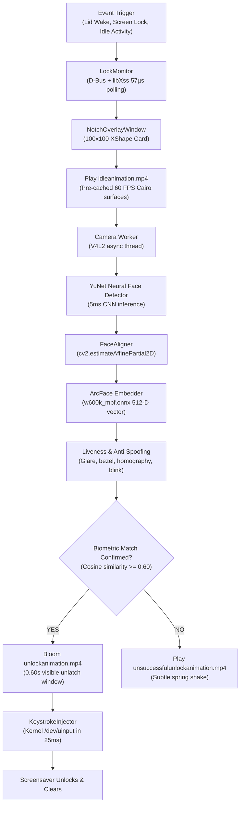

# Blink for Linux — Architecture & Deep Dive Notes

> Comprehensive reference guide explaining every subsystem, script, loop, neural network, and hardware integration in **Blink**.

---

## 1. The High-Level Summary (Elevator Pitch)

**Blink** is an on-device biometric Face ID screen unlock system for Linux.
When your screen locks, when you wake your laptop, or when you return to an idle PC and touch your keyboard/mouse:
1. A compact **100×100 px black squarish card with 22px rounded corners** pops down directly under your camera bezel.
2. It loops [`idleanimation.mp4`](file:///home/samayy/blink/blink/resources/idleanimation.mp4) while an asynchronous camera worker grabs frames.
3. A lightweight neural detector (**YuNet**) locates your face and facial landmarks in ~5ms.
4. An affine transformation normalizes your head tilt onto a canonical template.
5. A deep neural network (**ArcFace / MobileFaceNet**) converts your face into a 512-dimensional mathematical embedding vector.
6. A multi-cue anti-spoofing engine verifies that you are a living 3D human (not a phone screen or printed photo).
7. If the cosine similarity with your enrolled profile is $\ge 0.60$:
   - The card transitions to [`unlockanimation.mp4`](file:///home/samayy/blink/blink/resources/unlockanimation.mp4) and blooms green (holding for 0.60s so you see the unlock animation).
   - In parallel, your password is decrypted from an **AES-256-GCM** vault.
   - A persistent, pre-warmed virtual keyboard device in the Linux kernel (`/dev/uinput`) types your password directly into the screensaver input buffer in **< 25 milliseconds**.
   - Your screensaver unlocks and the card dismisses.

---

## 2. End-to-End Pipeline Diagram



---

## 3. Subsystem Breakdown

### A. Lock Detection & Auto-Idle Wake (`blink/system/lock_monitor.py`)
- **The Challenge**: When a PC automatically locks after 15 minutes of user absence, the screen is already locked and the display stays awake. When you return and move your mouse, traditional D-Bus wake signals do NOT fire because no power-state transition occurred.
- **The Solution**: 
  - Standard D-Bus listeners for Cinnamon (`org.cinnamon.ScreenSaver`), GNOME, and systemd-logind (`org.freedesktop.login1`).
  - Combined with a hardware-level C idle query: `libXss.so.1` (`XScreenSaverQueryInfo` via Python `ctypes`).
  - Polled every 400ms (latency: 57 microseconds). If the screen is locked and idle time drops from `> 2500ms` down to `< 800ms`, Blink detects physical user return and immediately arms the camera!

### B. Vision & Face Recognition Pipeline (`blink/vision/`)
1. **Asynchronous Frame Worker (`camera.py`)**:
   - Spawns a background thread that continuously pulls V4L2 webcam frames into a single-slot buffer.
   - Completely decouples camera I/O from the AI inference loop, preventing buffer latency and dropped frames.
2. **Neural Face Detection (`detector.py`)**:
   - Uses **YuNet** (from OpenCV Model Zoo), an ultra-fast CNN trained on WiderFace.
   - Detects face bounding boxes and 5 key landmarks: right eye, left eye, nose tip, right mouth corner, left mouth corner.
   - Includes continuity tracking (exponential moving average on bounding boxes) so bystanders passing behind you are ignored.
3. **Face Alignment & Normalization (`aligner.py`)**:
   - Uses `cv2.estimateAffinePartial2D` to map the 5 detected landmarks onto the standard ArcFace canonical 112×112 template.
   - Eliminates orientation variance: head tilt, pitch, and roll are mathematically aligned.
4. **ArcFace Deep Embeddings (`embedder.py`)**:
   - Passes the aligned 112×112 crop through **MobileFaceNet** (`w600k_mbf.onnx`).
   - Produces a 512-dimensional float vector and normalizes it to unit length (`L2 norm = 1.0`).
   - Compares the live vector against your enrolled embeddings using **Cosine Similarity**:
     $$\text{Similarity} = \vec{A} \cdot \vec{B} = \sum_{i=1}^{512} A_i B_i$$
   - If similarity $\ge 0.60$, identity is verified.

### C. Anti-Spoofing & Liveness Analyzer (`blink/liveness/`)
Prevents photo, tablet, or replay video attacks using 5 independent computer vision cues:
1. **Screen Glare Cue**: Detects concentrated high-luminance specular reflection clusters (typical of mobile glass screens).
2. **Device Bezel Cue**: Detects sharp, straight rectangular edges framing the face (phone or tablet borders).
3. **3D vs. Planar Homography**: A 2D photo shows zero planar residual error when rotating; real 3D faces display non-linear perspective deformation.
4. **Depth / Nose Parallax**: Measures nose displacement relative to the inter-ocular axis during natural head micro-movements.
5. **Blink Dynamics**: Computes Eye Aspect Ratio (EAR) dips and recoveries.

### D. Compact Lockscreen Popout Card (`blink/ui/notch_overlay.py`)
- **Proportions**: Compact 100×100 px squarish card with 22px rounded corners positioned in the center top under the camera bezel (`y = 12px`).
- **Hardware X11 XShape Masking**: When reparented into `cinnamon-screensaver-window`, child windows lose alpha blending unless an XShape mask is applied. Blink generates a 1-bit alpha mask (`cairo.FORMAT_A1`) and applies it via `shape_combine_region()`, cutting out the corners at the X11 server level!
- **Pre-Cached 60 FPS Video Playback**:
  - Pre-decodes `idleanimation.mp4`, `unlockanimation.mp4`, and `unsuccessfulunlockanimation.mp4` into memory as 100×100 Cairo `ImageSurface` buffers.
  - Painting each frame takes `< 0.05ms` (0.0% CPU decoding penalty during lockscreen wake).
- **Zero Text**: Pure minimalist aesthetic — only the animations display.

### E. Instant Keystroke Injection (`blink/system/keystroke_injector.py`)
- **The Bottleneck**: Standard Linux tools recreate `/dev/uinput` devices on every run, forcing the kernel and `udev` to probe and register new devices (~2000ms delay).
- **The Optimization**: Blink maintains a **persistent, pre-warmed singleton `UInput` virtual keyboard device** in kernel memory.
- **Microsecond Typing**: Injects keystrokes at batch rates (~2ms per character). A 10-character password + Enter is typed in **< 25 milliseconds**.
- **0.60s Bloom Window**: The coordinator pauses for 0.60s upon face match so the unlock animation visually opens and turns green before the keystrokes dismiss the lockscreen.

### F. Security & Cryptographic Vault (`blink/core/crypto.py`)
- **AES-256-GCM Authenticated Encryption**: Both your user password and facial embeddings are encrypted at rest.
- **PBKDF2 Key Derivation**: 100,000 iterations using a combined salt derived from `/etc/machine-id` and local random salt (`~/.config/blink/salt.bin`).
- **Plaintext Zeroing**: Plaintext memory buffers are overwritten with zeros immediately after keystroke emission.

---

## 4. Codebase Directory Map

```text
blink/
├── bin/
│   └── blink                           # Executable bash launcher wrapper
├── blink/
│   ├── main.py                         # CLI dispatcher & entrypoint
│   ├── core/
│   │   ├── config.py                   # BlinkSettings dataclass (~/.config/blink/)
│   │   ├── coordinator.py              # Master pipeline orchestrator
│   │   └── crypto.py                   # AES-256-GCM vault & PBKDF2 key generator
│   ├── vision/
│   │   ├── camera.py                   # Multi-threaded asynchronous V4L2 worker
│   │   ├── detector.py                 # YuNet neural face detection & 106 landmarks
│   │   ├── aligner.py                  # 5-point affine transformation matrix
│   │   └── embedder.py                 # ArcFace 512-D ONNX embedding model
│   ├── liveness/
│   │   ├── analyzer.py                 # Anti-spoofing decision engine
│   │   ├── cues.py                     # Data models for liveness cues
│   │   └── extractors.py               # Glare, bezel, depth, and blink extractors
│   ├── ui/
│   │   ├── notch_overlay.py            # 100x100 XShape popout card & 60 FPS player
│   │   ├── settings_window.py          # GTK 3 GUI Settings & live Face Lab diagnostics
│   │   └── enrollment_dialog.py        # 5-pose guided hands-free enrollment wizard
│   ├── system/
│   │   ├── lock_monitor.py             # D-Bus + libXss hardware idle monitor
│   │   └── keystroke_injector.py       # Persistent kernel /dev/uinput keyboard
│   └── resources/
│       ├── final.png                   # Custom high-res logo
│       ├── appicon.png                 # 512x512 downsampled application icon
│       ├── blink-logo.svg              # Scalable vector icon
│       ├── idleanimation.mp4           # 60 FPS scanning loop
│       ├── unlockanimation.mp4         # 60 FPS unlock bloom
│       └── unsuccessfulunlockanimation.mp4 # 60 FPS error shake
├── models/                             # ONNX neural weights (YuNet, ArcFace, 2D106)
├── service/
│   └── blink.service                   # Systemd user service unit
└── tests/
    └── test_suite.py                   # 10-test automated verification suite
```

---

## 5. Cheat Sheet of Commands

```bash
# General CLI Commands
blink status            # View camera, encryption, enrolled face profiles, and daemon health
blink settings          # Open graphical settings, Face Lab debugger, and enrollment
blink test-scan         # Test 100x100 popout card and animation directly on desktop
blink daemon            # Run background daemon interactively in terminal (with live logs)
blink install-desktop   # Install system menu launcher and desktop shortcut
blink autostart         # Register daemon to launch on user login

# Managing the Background Daemon
systemctl --user status blink       # Check daemon status and recent logs
systemctl --user restart blink      # Restart the background daemon
systemctl --user stop blink         # Stop the background daemon
journalctl --user -u blink -f       # Follow live daemon logs in real-time

# Running Automated Unit Tests
python tests/test_suite.py          # Runs full 10-test suite (0.33s execution)
```

---

## 6. How to Explain This in an Interview or Conversation

> **Q: "How does your face unlock app actually work?"**

1. **"It runs 100% locally on CPU without GPUs or cloud servers."**  
   "It uses ONNX Runtime with AVX2 acceleration. A YuNet model locates the face in ~5 milliseconds, an affine transformation warps it to normalize head tilt, and MobileFaceNet extracts a 512-dimensional vector. Matching is a single dot product comparing cosine similarity against enrolled vectors."

2. **"It solves the Linux screensaver isolation barrier with `/dev/uinput`."**  
   "Linux screensavers are designed not to accept arbitrary window manager injection. Rather than hacking PAM or individual display managers, Blink acts as a virtual hardware USB keyboard at the kernel layer using Linux `/dev/uinput`. By keeping the virtual keyboard device persistent in memory, it types credentials in under 25 milliseconds."

3. **"It catches returning users through hardware idle counter tracking."**  
   "When a PC locks itself after 15 minutes of inactivity, traditional D-Bus wake events don't fire when someone moves the mouse. Blink queries `XScreenSaverQueryInfo` via `ctypes` in 57 microseconds. The moment idle time drops, it immediately arms the camera."

4. **"It delivers smooth 60 FPS animations using Cairo and X11 XShape."**  
   "The overlay card is a 100×100 px squircle that uses X11 XShape masking to physically cut out rounded corners at the server level. Video frames are pre-decoded into RAM as Cairo surfaces, allowing buttery-smooth 60 FPS playback with zero decoding CPU overhead."
